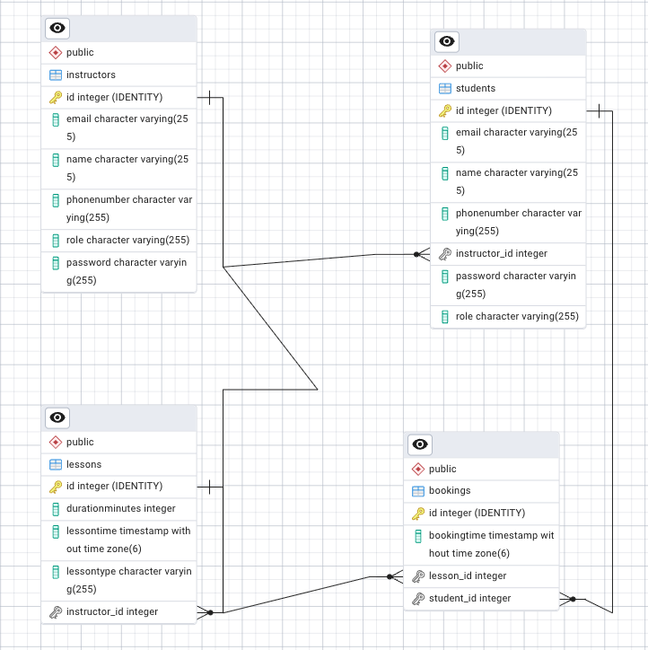
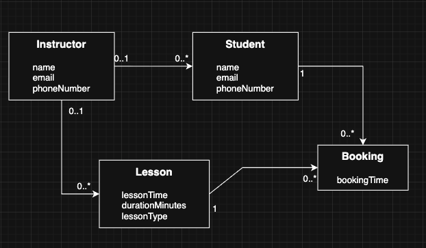

## Vision

Our goal with DriveApp was to create a backend system for a driving school that makes it easier to manage students, instructors, driving lessons, and bookings.

Students can create an account, log in, view available driving lessons, and book a lesson. Instructors can manage student information, create and update lessons, and keep track of bookings.

We also wanted to include something extra in our project, so we added an AI driving assistant using Google Gemini. The assistant allows students to ask questions about driving theory, traffic rules, and road safety.

We developed DriveApp as our third-semester backend project to use what we have learned about Java, REST APIs, databases, security, testing, and deployment. Our focus was to build a working backend where the different parts of the application work together.

---

## Project Links

| Resource | Description | Link |
|---|---|---|
| **GitHub Repository** | Complete source code, documentation, and project development. | [DriveApp Repository](https://github.com/Musa-909/DriveApp) |
| **Live Application** | Deployed REST API running on our production server. | [https://driveapp.website](https://driveapp.website) |
| **API Health Check** | Endpoint used to verify that the backend is running. | [GET /api/health](https://driveapp.website/api/health) |
| **Project Video** | Short walkthrough of the system, architecture, and main features. | Coming soon |

---

## Group Project

DriveApp is a collaborative third-semester backend examination project developed by **Amaan Mahomed** and **Musa Sayed**. We worked together on designing, implementing, testing, documenting, and deploying the application.

| Team Member | Project Contribution | GitHub | Portfolio |
|---|---|---|---|
| **Amaan Mahomed** | Backend development, testing, documentation, and deployment | [@AmaanM3](https://github.com/AmaanM3) | [View Portfolio](https://amaanm3.github.io/portfolio2026/) |
| **Musa Sayed** | Backend development, testing, documentation, and deployment | [@Musa-909](https://github.com/Musa-909) | Coming soon |

---

## Relevant Course Topics

During our third semester, we have worked with different backend topics that we have used in DriveApp.

The table below shows the main course topics and how we have applied them in our project.

| Course Topic | How We Used It in DriveApp | Course Material |
|---|---|---|
| **01 JPA Basics** | We used Hibernate/JPA and DAO classes to store and manage data in PostgreSQL. | [JPA Basics](https://3sem.kursusmaterialer.dk/backend/jpa-basics/) |
| **02 JPA Relations** | We created relationships between students, instructors, lessons, and bookings. | [JPA Relations](https://3sem.kursusmaterialer.dk/backend/jpa-relations/) |
| **03 Data Integration** | We used DTOs, JSON, and Java HttpClient to exchange data and communicate with Google Gemini. | [Data Integration](https://3sem.kursusmaterialer.dk/backend/data-integration/) |
| **04 Concurrency** | We used `CompletableFuture` to handle asynchronous HTTP requests to Google Gemini. | [Concurrency](https://3sem.kursusmaterialer.dk/backend/concurrency/) |
| **05 REST API Intro** | We built our REST API using Javalin, routes, controllers, and HTTP methods. | [REST API Intro](https://3sem.kursusmaterialer.dk/backend/rest-intro/) |
| **06 REST & Test** | We used JUnit and REST Assured to test our API endpoints and functionality. | [REST & Test](https://3sem.kursusmaterialer.dk/backend/rest-test/) |
| **07 Security** | We implemented JWT authentication, BCrypt password hashing, and role-based authorization. | [Security](https://3sem.kursusmaterialer.dk/backend/security/) |
| **08 Deployment & DevOps** | We used GitHub Actions, Docker, Docker Hub, and DigitalOcean to deploy our backend. | [Deployment & DevOps](https://3sem.kursusmaterialer.dk/backend/deployment/) |

These topics helped us apply what we learned during the semester to a working backend application.

---

## Architecture

### System Overview

DriveApp is built as a layered Java backend using Javalin, Hibernate/JPA, and PostgreSQL. We have separated the application into different layers to make the code easier to understand, maintain, and work with.

Javalin handles the HTTP requests and connects them to the correct routes and controllers. The controllers handle incoming data, validate requests, and manage the application logic. We use DAO classes to communicate with the database through Hibernate/JPA, while PostgreSQL stores information about students, instructors, lessons, and bookings.

We have also implemented JWT authentication and role-based authorization to protect our endpoints and control which features students and instructors can access.

The application includes an AI driving assistant, where students can ask questions about driving theory and traffic rules. These requests are handled by `DrivingAiService`, which communicates with the Google Gemini API.

### Technologies

- Java 17
- Maven
- Javalin
- Hibernate / JPA
- PostgreSQL
- HikariCP
- Jackson
- Lombok
- JWT & BCrypt
- Google Gemini API
- JUnit & REST Assured
- Testcontainers
- Docker & Docker Hub
- GitHub Actions
- DigitalOcean
- Caddy & Watchtower
- DanDomain (Domain & DNS)

---

## Architecture Diagram

The architecture diagram shows how the different parts of DriveApp work together. It gives an overview of how HTTP requests are handled, how data is stored in the database, and how our AI assistant connects to Google Gemini.


We use Javalin to handle HTTP requests, controllers to manage application logic, and DAO classes with Hibernate/JPA to communicate with PostgreSQL.

JWT authentication protects our endpoints. Registration, login, and health checks are public, while the other endpoints require a valid token. Our AI assistant is handled through `DrivingAiService`, which communicates with the Google Gemini API.

## Key Design Decisions

**Layered Architecture and DTOs.** 
We separated our code into routes, controllers, and DAO classes to keep the project organized. We also use DTOs to control what data is sent and received through our API, so sensitive information like passwords is not returned.

**Authentication and Roles.** 
We use BCrypt to hash passwords and JWT for authentication. Students and instructors have different roles, which determine what they are allowed to access. Students can only manage their own profile, while instructors have access to administrative features.

**Bookings and Availability.** 
Students can book available driving lessons. Before creating a booking, we check that the student and lesson exist and that the lesson has not already been booked. Available lessons are found by checking which lessons have no bookings.

**AI Integration.**
We integrated Google Gemini through our `DrivingAiService` class. We use Java HttpClient and `CompletableFuture` to send questions to Gemini and receive answers. The API waits for the AI response before returning it to the user.

**Error Handling and Logging.** We use HTTP status codes, validation, and JSON error messages to handle invalid requests. We also use logging to keep track of requests and unexpected errors.

---

## Data Model

### Entity Relationship Diagram (ERD)

The ERD shows how our PostgreSQL database is structured, including the tables, attributes, and relationships between students, instructors, lessons, and bookings.



### Domain Model

The domain model shows the main concepts in our driving school system and how they are connected, without focusing on database details.



### Important Entities

| Entity | Purpose | Relationships |
|---|---|---|
| **Student** | Stores student information, login details, and contact information. | Can have an instructor and multiple bookings. |
| **Instructor** | Stores instructor information and login details. | Can have multiple students and lessons. |
| **Lesson** | Represents a driving lesson with a time, duration, and lesson type. | Can have an instructor and be connected to bookings. |
| **Booking** | Connects a student to a driving lesson. | Must reference a student and a lesson. |

---

# API Documentation

DriveApp provides a REST API for managing students, instructors, driving lessons, and bookings. The API also includes an AI driving assistant that can answer questions about driving theory and traffic rules.

**Local URL:** `http://localhost:7070`

**Production URL:** `https://driveapp.website`

## Endpoint Overview

| Area | Main Endpoints | Access |
|---|---|---|
| **Health** | `GET /api/health` | Public |
| **Registration & Login** | `POST /api/students`, `POST /api/students/login`, `POST /api/instructors/login` | Public |
| **Students** | `GET /api/students`, `GET/PUT/DELETE /api/students/{id}` | JWT, role and ownership checks |
| **Instructors** | `GET/POST /api/instructors`, `GET/PUT/DELETE /api/instructors/{id}` | Instructor |
| **Lessons** | `GET/POST /api/lessons`, `GET/PUT/DELETE /api/lessons/{id}`, `GET /api/lessons/available` | JWT, instructor required for changes |
| **Bookings** | `GET/POST /api/bookings`, `GET/PUT/DELETE /api/bookings/{id}` | JWT, role and ownership checks |
| **AI Assistant** | `POST /api/ai/driving-advice` | JWT |

We use JWT authentication to protect our endpoints. Students can view and update their own profiles, while instructors can manage student information, lessons, and bookings.

Students can also view available driving lessons and create bookings for themselves. An instructor account is required to create, update, or delete driving lessons.

## Example Endpoints

Below are some examples of how we use the main endpoints in DriveApp.

### 1. Student Login

Students can log in using their email and password. If the login is successful, the API returns a JWT token.

**Request:**

```http
POST /api/students/login
Content-Type: application/json
```

```json
{
  "email": "student@example.com",
  "password": "your-password"
}
```

**Response – 200 OK:**

```json
{
  "message": "Login successful",
  "token": "eyJhbGciOiJIUzI1NiJ9..."
}
```

The token must be included in the header when accessing protected endpoints:

```http
Authorization: Bearer <token>
```

An incorrect email or password returns `401 Unauthorized`.

### 2. View Available Lessons

Students can see which driving lessons are available before making a booking.

**Request:**

```http
GET /api/lessons/available
Authorization: Bearer <token>
```

**Response – 200 OK**

The API returns a JSON list of lessons that have not been booked yet.

### 3. Book a Driving Lesson

A student can book an available driving lesson by sending a booking request.

**Request:**

```http
POST /api/bookings
Authorization: Bearer <token>
Content-Type: application/json
```

```json
{
  "bookingTime": "2026-11-10T10:00:00",
  "studentId": 1,
  "lessonId": 2
}
```

**Response – 201 Created:**

```json
{
  "id": 1,
  "bookingTime": "2026-11-10T10:00:00",
  "studentId": 1,
  "lessonId": 2
}
```

Before saving the booking, the API checks that the student and lesson exist and that the lesson is not already booked.

If the lesson has already been booked, the API returns `400 Bad Request`.

### 4. Ask the AI Driving Assistant

Students can ask the AI assistant questions about driving theory, traffic rules, and road safety.

**Request:**

```http
POST /api/ai/driving-advice
Authorization: Bearer <token>
Content-Type: application/json
```

```json
{
  "question": "What does a triangular traffic sign mean?"
}
```

**Response – 200 OK:**

```json
{
  "answer": "A triangular traffic sign is usually a warning sign that alerts drivers to possible dangers ahead."
}
```

The question is sent to Google Gemini through our `DrivingAiService`, and the generated answer is returned as JSON.

## HTTP Status Codes

We use HTTP status codes to indicate whether a request was successful or if something went wrong.

| Status Code | How We Use It in DriveApp |
|---|---|
| `200 OK` | Returned when data is retrieved or updated successfully, or when a user logs in. |
| `201 Created` | Returned when a student, instructor, lesson, or booking is created. |
| `204 No Content` | Returned when a student, instructor, lesson, or booking is deleted. |
| `400 Bad Request` | Returned when a request contains invalid data, an AI question is empty, or a lesson is already booked. |
| `401 Unauthorized` | Returned when login credentials are incorrect or a required JWT is missing or invalid. |
| `403 Forbidden` | Returned when a user does not have permission to perform an action or access another student's information. |
| `404 Not Found` | Returned when a requested student, instructor, lesson, or booking does not exist. |
| `500 Internal Server Error` | Returned when an unexpected error occurs in the application. |

## User Stories

We created 10 user stories to describe the main features of DriveApp from the perspective of students and instructors.

The user stories helped us plann the project and decide which features to focus on. We prioriitized the most important functionality, such as registration, login, driving lessons, and bookings, while also including profile management and our AI driving assistant.

| ID | User story | Priority |
|---|---|---|
| US-01 | As a student, I want to register an account, so I can access the driving school's services. | High |
| US-02 | As a student or instructor, I want to log in securely, so I can access protected features of the application. | High |
| US-03 | As a student, I want to view available driving lessons, so I can find a lesson that fits my schedule. | High |
| US-04 | As a student, I want to book a driving lesson, so I can reserve my preferred time. | High |
| US-05 | As a student, I want to view and update my own profile securely, so I can keep my personal information accurate and protected. | Medium |
| US-06 | As an instructor, I want to view, update and delete student information, so I can keep student records organized and up to date. | High |
| US-07 | As an instructor, I want to create, update and delete driving lessons, so I can organize the driving school's lessons. | High |
| US-08 | As an instructor, I want to view and manage student bookings, so I can keep track of scheduled driving lessons. | Medium |
| US-09 | As an instructor, I want to view and manage instructor information, so I can keep instructor records up to date. | Medium |
| US-10 | As a student, I want to ask an AI assistant questions about driving theory and traffic rules, so I can receive relevant driving advice. | Medium |

---

# Development notes

## Run Locally

To run DriveApp locally, we need Java 17, Maven, and a running PostgreSQL database.

### Requirements

- JDK 17
- Maven
- PostgreSQL
- IntelliJ IDEA (optional)

### Setup

**1. Clone the repository**

```bash
git clone https://github.com/Musa-909/DriveApp.git
cd DriveApp
```

**2. Configure the database**

We use two separate PostgreSQL databases in DriveApp:

- **Test Database:** Used for our automated REST Assured tests in GitHub Actions (`driveapp_test`).
- **Production Database:** Used by our deployed application on `driveapp.website`.

This keeps our test data separate from the production data.

When running the application locally, PostgreSQL must be running and a database must be available.

Create `src/main/resources/config.properties` with the following settings:

```properties
DB_NAME=driveapp_test
DB_USERNAME=postgres
DB_PASSWORD=your-local-password
```

These are example values. The database name, username, and password must match the PostgreSQL setup on your computer. The local application does not automatically connect to the test database running in GitHub Actions.

**3. Set environment variables**

For local execution, we use:

- `JWT_SECRET` – Required for JWT authentication.
- `GEMINI_API_KEY` – Required when using the AI driving assistant.

The local database connection is configured through `config.properties`, so `DB_NAME`, `DB_USERNAME`, and `DB_PASSWORD` do not need to be set separately as environment variables.

Do not set `DEPLOYED` when running locally, because that makes the application use the deployed database configuration instead.

**4. Run the application**

We can start DriveApp by running the `main()` method in `Main.java` through IntelliJ IDEA. This calls `Application.main()`, which starts our Javalin REST API.

Alternatively, we can build and run the application through the terminal:

```bash
mvn clean package -DskipTests
java -jar target/app.jar
```

The application runs on:

`http://localhost:7070`

We can check if the REST API is running by opening:

`http://localhost:7070/api/health`

### Creating the First Instructor

Creating an instructor through `POST /api/instructors` requires an existing instructor account with a valid JWT token. Therefore, the first instructor must be added directly to the database with a BCrypt-hashed password. Once the account has been created, the instructor can log in through `POST /api/instructors/login` and create additional instructor accounts through the API.

## Tests

We use **JUnit and REST Assured** to test DriveApp and verify that our backend works as expected.

Our tests cover different parts of the application:

- **API Tests:** Testing endpoints for students, instructors, lessons, bookings, and our AI assistant.
- **DAO Tests:** Testing database operations such as creating, retrieving, updating, and deleting data.
- **Security Tests:** Testing JWT authentication, BCrypt password hashing, and role-based authorization.
- **AI Tests:** Testing our `DrivingAiService` and how it handles responses from Google Gemini.

### Automated Testing with GitHub Actions

We use GitHub Actions to automatically build and test DriveApp whenever changes are pushed to the `main` branch. The workflow can also be started manually.

Our testing workflow:

1. Starts a PostgreSQL 16 test database called `driveapp_test`.
2. Sets up Java 17 and builds the application using Maven.
3. Starts the DriveApp REST API on port `7070` and checks that the health endpoint responds.
4. Creates test accounts for a student and an instructor.
5. Runs the automated tests using `mvn test`.
6. Stops the running API after testing.
7. Builds and pushes the Docker image to Docker Hub if the previous steps succeed.

The test database is separate from our production database, so automated tests do not affect real application data.

### Running Tests Locally

To run the tests locally, PostgreSQL must be running with a configured test database.

The DriveApp API must also be running on port `7070`, and the required test accounts and environment variables must be configured.

Once the test environment is ready, run:

```bash
mvn test
```

This allows us to test our application locally before pushing changes to GitHub.

By using automated testing in our CI/CD pipeline, we can verify that our backend works correctly before a new Docker image is pushed to Docker Hub and deployed through Watchtower.
## CI/CD and Deployment

We use GitHub Actions, Docker, Docker Hub, and DigitalOcean to build, test, and deploy DriveApp.

### CI/CD Pipeline

When we push changes to `main`, GitHub Actions:

1. Builds our Java application using Maven.
2. Starts a PostgreSQL test database and runs our automated tests.
3. Builds and pushes our Docker image to Docker Hub (`amaanm3/driveapp:latest`) if the tests pass.

### Deployment

Our backend runs in Docker on a DigitalOcean server. Watchtower automatically checks Docker Hub for new images and updates the application.

We use **DanDomain** for our domain name and DNS settings, connecting `driveapp.website` to our server. **Caddy** provides HTTPS for secure access to the REST API.

**Live API:** https://driveapp.website

**Health Check:** https://driveapp.website/api/health

Passwords, database credentials, and API keys are configured through environment variables and GitHub Secrets.

## Lessons Learned

During the development of DriveApp, we gained experience with different backend technologies and working together as a team.

- **Backend Development:** Structuring our API with Javalin, controllers, DTOs, and DAOs.
- **Database:** Working with PostgreSQL, Hibernate/JPA, and entity relationships.
- **Security:** Implementing JWT authentication, BCrypt, and role-based authorization.
- **Testing:** Writing API and database tests using JUnit and REST Assured.
- **Deployment:** Setting up CI/CD with GitHub Actions, Docker, and DigitalOcean.
- **AI Integration:** Connecting our backend to Google Gemini.
- **Teamwork:** Collaborating through GitHub and solving problems together.

Overall, the project helped us understand how to build, test, and deploy a complete backend application.
